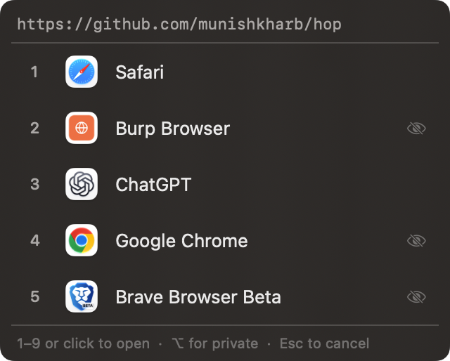

# hop

A macOS browser picker. hop catches every link you open and either sends it straight to the right browser by your rules, or shows a fast picker so you choose in one keystroke.

<p align="center"></p>

- **Rules**: match a link by domain or path and send it straight to a chosen browser. Links with no matching rule go to the picker.
- **Picker**: a small panel at the pointer. Press 1–9 or click to open; hold ⌥ to open in a private window.
- **History**: see what opened where, and reopen recent links from the menu bar.
- **Velja import**: bring your existing Velja rules over.

## Keys

| In the picker | Does |
|---|---|
| `1`–`9` or click | Open the link in that browser |
| `⌥` + number or `⌥`-click | Open it in a private window (Chrome, Brave, Edge, Arc, Chromium, Firefox) |
| `Esc` or click away | Close the picker without opening anything |

## Install
Needs macOS 13 or later, on Apple silicon or Intel.

1. Download `Hop-<version>.dmg` from the [latest release](https://github.com/munishkharb/hop/releases/latest) and drag Hop into Applications.
2. hop is not notarized by Apple yet, so the first launch is blocked. Open it once, then go to System Settings → Privacy & Security and click **Open Anyway**. Or clear the download flag yourself: `xattr -dr com.apple.quarantine /Applications/Hop.app`.
3. Set hop as your default browser (hop's Settings → General has a button for it), and it takes over link handling.

Each release also carries a `.zip` of the app and `SHA256SUMS` for both files.

## Build
Needs Xcode 15 or later.
```
scripts/package.sh            # dist/Hop.app, Hop-<version>.dmg, Hop-<version>.zip
swift build -c release        # the bare binary only
```

## License
MIT. See [LICENSE](LICENSE).
